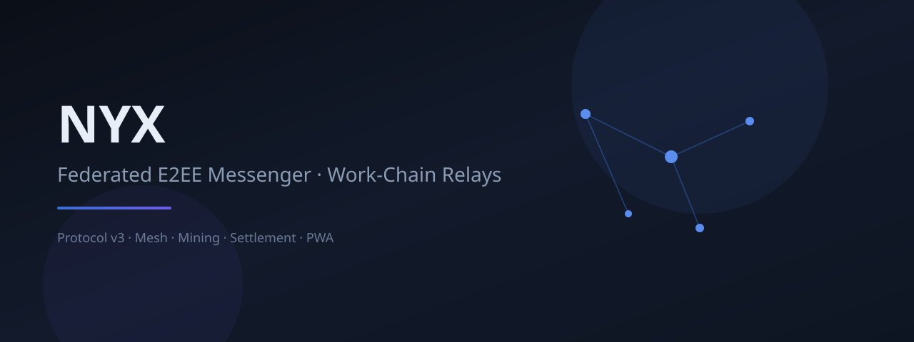

  

# NYX Messenger (فارسی)

پیام‌رسان **فدریتیو** با رمزنگاری سرتاسر (E2EE)، رله روی هاست‌های معمولی، شبکه mesh، و پاداش **بر اساس فعالیت واقعی** نه پردازش بیهوده.

## شروع سریع
- کلاینت: `/client.html`
- وضعیت شبکه: `/status.html`
- سلامت: `/api/v3/ops/selftest`

## ماینینگ
اعتبار `NYX` برای کار مفید رله (مثلاً رله پیام پس از ارسال واقعی) در نظر گرفته می‌شود.  
جزئیات: [docs/MINING.md](docs/MINING.md)

## مستندات
- نصب: [docs/INSTALL.md](docs/INSTALL.md)
- امنیت: [docs/SECURITY_AUDIT_49.md](docs/SECURITY_AUDIT_49.md)
- نسخه انگلیسی کامل: [README.md](README.md)

## توسعه
`Issue → Branch → Test → Pull Request → Merge`

