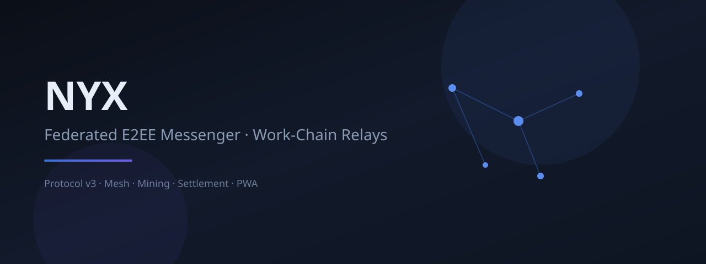
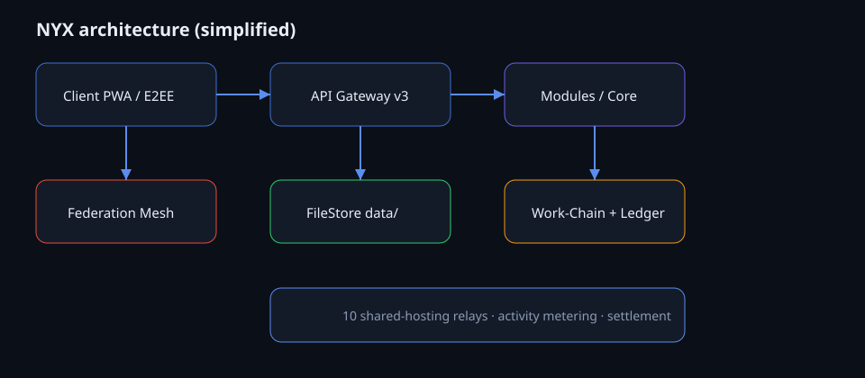

<p align="center">
  
</p>

<p align="center">
  <strong>Federated end-to-end encrypted messenger</strong><br/>
  Shared-hosting relays · Mesh federation · Activity-metered work-chain · PWA
</p>

<p align="center">
  <a href="https://github.com/Mr-A01/Nyx/actions"></a>
  <a href="https://github.com/Mr-A01/Nyx/stargazers"></a>
  <a href="https://github.com/Mr-A01/Nyx/network/members"></a>
  
  
  
</p>

<p align="center">
  <a href="docs/site/index.html">Docs site</a> ·
  <a href="README-fa.md">فارسی</a> ·
  <a href="docs/INSTALL.md">Install</a> ·
  <a href="docs/MINING.md">Mining</a> ·
  <a href="docs/SECURITY_AUDIT_49.md">Security tracker</a> ·
  <a href="https://github.com/Mr-A01/Nyx/issues">Issues</a>
</p>

---

## Why NYX?

Most messengers lock you into a single cloud. **NYX** is a **relay mesh**: each node is a small PHP app that can live on ordinary shared hosting. Clients speak a stable **API v3**, encrypt on-device, and treat servers as transport + optional durable store — not as the source of truth for private content.

| Pillar | What you get |
|--------|----------------|
| **Privacy** | Client-side E2EE (libsodium) · server stores ciphertext by default |
| **Federation** | Multi-domain topology · gossip · peer signatures |
| **Resilience** | 10+ production relays · selftest · mesh health |
| **Incentives** | **Activity-metered** NYX credits for *real* relay work (not idle hashing) |
| **Portable** | Shared hosting *or* Docker (`ghcr.io/mr-a01/nyx`) · PWA installable UI |

<p align="center">
  
</p>

---

## Quick start

### Shared hosting (production style)

1. Deploy so the web root is **`public/`** (see root `.htaccess` rewrite).
2. Ensure `data/` (or configured `DATA_DIR`) is writable and **not** web-exposed.
3. Open:
   - `/client.html` — messenger PWA  
   - `/status.html` — live mesh globe  
   - `/api/v3/ops/selftest` — health JSON  

### Local

```bash
composer install
cp .env.example .env
php -S 0.0.0.0:8080 -t public
```

### Docker

```bash
docker pull ghcr.io/mr-a01/nyx:latest
docker run -p 8080:80 -v nyx-data:/var/www/html/data ghcr.io/mr-a01/nyx:latest
```

Images publish from `main` via GitHub Actions → **GHCR**.

---

## Architecture (hexagonal / modular)

```
public/          → web entry, assets, PWA shell
app/Core         → HTTP, routing, security, rate limits, maintenance GC
app/Modules/*    → Identity · Messaging · Federation · Mining · Ledger · Settlement …
app/Shared       → FileStore, AccessGuard, AuthContext, envelopes
data/            → JSON source of truth (optional MESSAGE_DB=sqlite index only)
docs/            → install, mining, chain, security audit, site/
```

Namespace: **`Nyx\`** → `app/` (PSR-4).

---

## Mining model (activity-based)

NYX does **not** burn CPU on proof-of-work hashes.

1. Useful node activity is **metered on the server** (e.g. successful `message_relay` after a real send, `selftest_pass`).
2. Miners **claim unclaimed units** for those types — empty meter ⇒ no reward.
3. Credits land on the **ledger** and are sealed into a local **work-chain** (hash-linked, optional operator Ed25519 signatures).

See [`docs/MINING.md`](docs/MINING.md) for rates, caps, nonces (anti-replay only), and env flags.

---

## Security posture

Recent hardening (issue **#49** batches):

- Server-generated user IDs (no client takeover)
- Conversation ACL on sync / events / threads / forward
- Federation SSRF guards + optional peer HMAC
- Session + soft device bind · strict mode available
- Attachment & push ownership checks
- Ledger transfer locks · settlement finalize gates

Tracker: [`docs/SECURITY_AUDIT_49.md`](docs/SECURITY_AUDIT_49.md)

Report sensitive issues privately when possible; public tracking via GitHub Issues.

---

## Repository layout & docs

| Path | Purpose |
|------|---------|
| [`docs/INSTALL.md`](docs/INSTALL.md) | Deploy on shared hosting |
| [`docs/NODE.md`](docs/NODE.md) | Operator runbook + `POST /api/v3/ops/gc` |
| [`docs/CHAIN.md`](docs/CHAIN.md) | Work-chain format |
| [`docs/SETTLEMENT.md`](docs/SETTLEMENT.md) | Settlement batches |
| [`docs/site/`](docs/site/) | GitHub Pages landing |
| [`CONTRIBUTING.md`](CONTRIBUTING.md) | Branch → PR workflow |
| [`SECURITY.md`](SECURITY.md) | Vulnerability reporting |
| [`CODE_OF_CONDUCT.md`](CODE_OF_CONDUCT.md) | Community standards |
| [`docs/README.md`](docs/README.md) | Docs index |

---

## Development workflow

```text
Issue → branch (fix/… or feat/…) → host/test → Pull Request → merge → delete branch
```

Never land experimental patches straight on `main` without a PR.

```bash
git checkout -b feat/my-change
# … implement & test …
git push -u origin HEAD
# open PR → review → squash merge
```

---

## Status API cheatsheet

| Endpoint | Auth | Notes |
|----------|------|-------|
| `GET /api/v3/ops/selftest` | public | Node health |
| `GET /api/v3/ops/network` | public | Mesh snapshot |
| `POST /api/v3/ops/gc` | Bearer | Maintenance GC |
| `GET /api/v3/mining/status` | optional | Rates + **activity meter** |
| `POST /api/v3/mining/submit` | Bearer | Claim **metered** units |
| `GET /api/v3/chain/tip` | public | Local chain tip |

---

## License

Proprietary — all rights reserved unless a separate license file states otherwise.

<p align="center">
  <br/>
  <sub>Built for real relays — not idle hashing.</sub>
</p>
